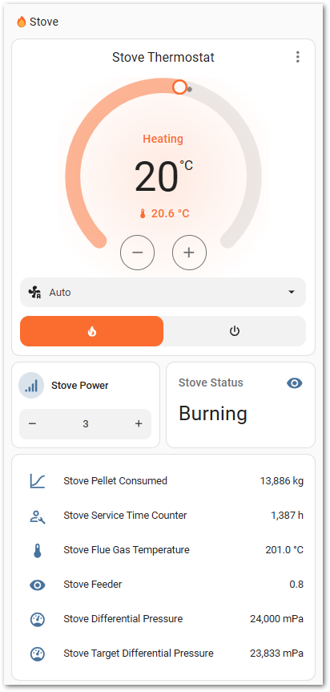
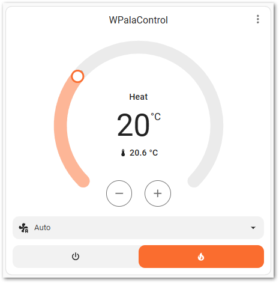
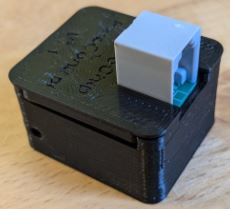
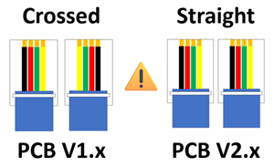
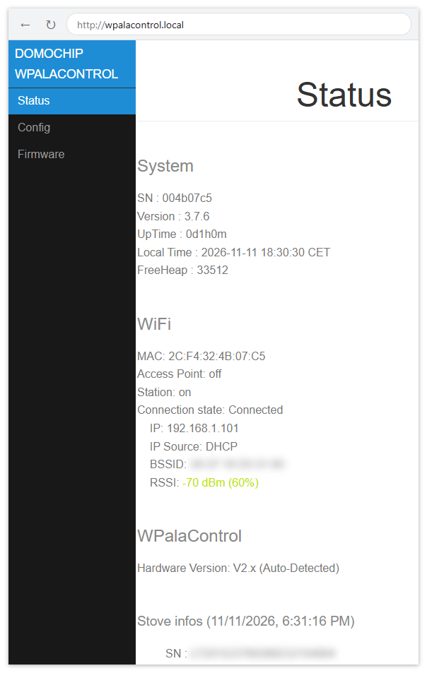
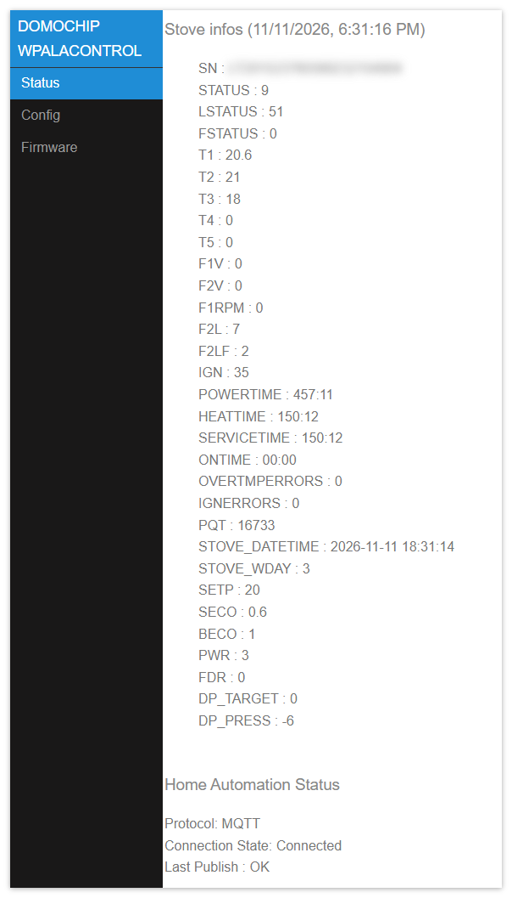
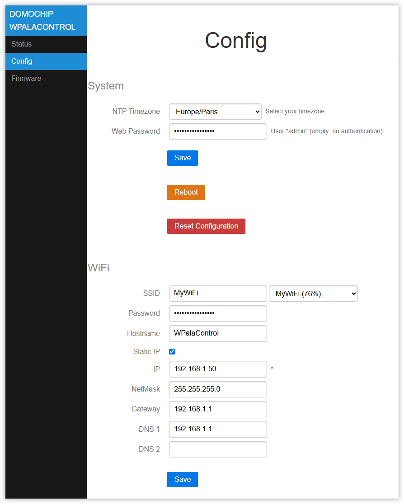
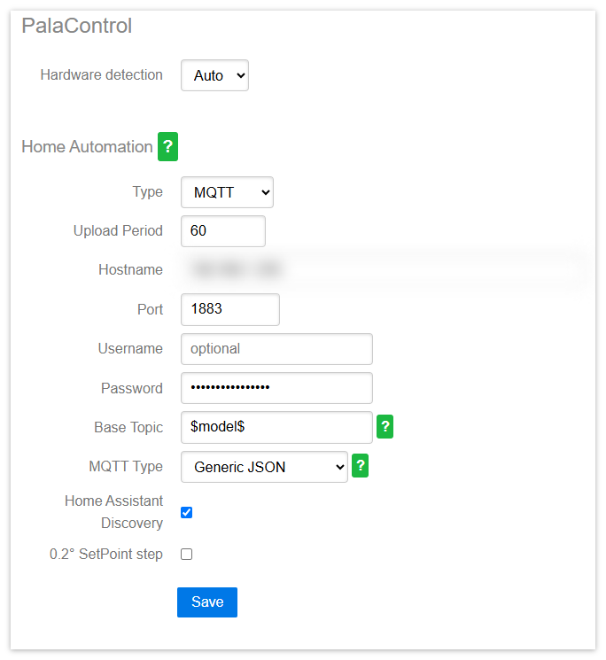
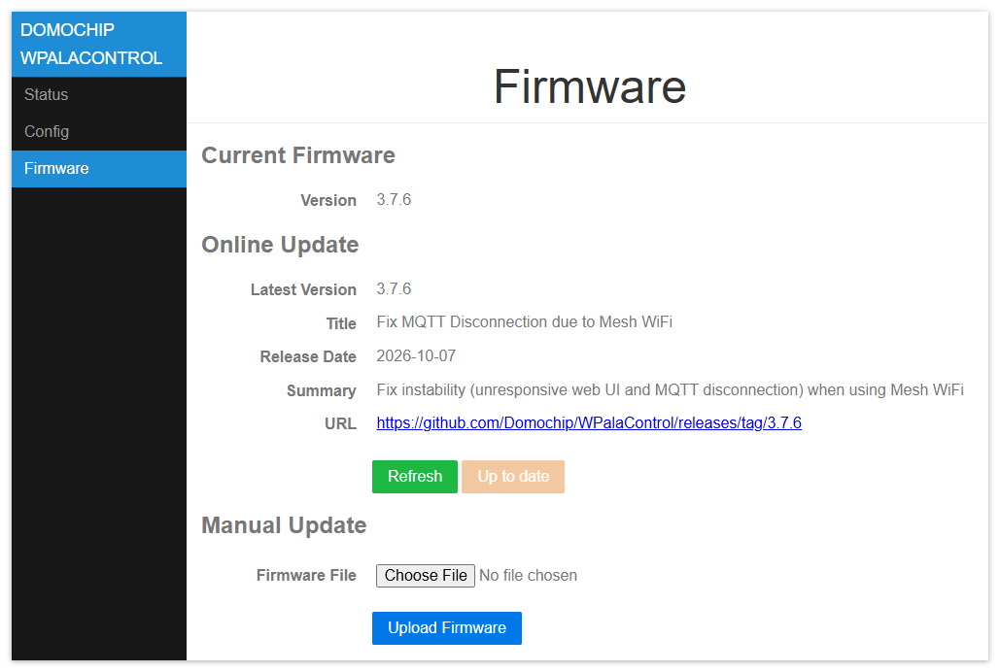

# WPalaControl

**WPalaControl** is a device designed to control and monitor Fumis-based stoves using a D1 Mini.  
It allows you to power on/off, adjust the set point, change fan speeds, and retrieve status, alarms, and temperature data from your stove.  

It supports native HTTP requests which makes it fully compatible with all existing Palazzetti/Fumis home automation plugins/apps.  

It also integrates with MQTT to monitor/control your stove in a much more efficient way.  

## Stove Compatibility

WPalaControl is compatible with stoves using the Fumis Controller, which is used by many manufacturers, including:  
  
Palazzetti / Jotul / TurboFonte / Godin / Fonte Flamme / Invicta / Casatelli / Alpis / Faizen / HETA / ...

To determine if your stove is compatible with WPalaControl, look for the following Control Panel or Motherboard:  


## Home Automation compatibility

|  | [MQTT Integration](https://www.home-assistant.io/integrations/mqtt/) (autodiscovery) <br> Most options and fans control |  |
| ------------- | ------------- | ------------- |
|  | [Palazzetti Integration](https://www.home-assistant.io/integrations/palazzetti)<br> (2024.11 minimum) <br> Basic implementation for now |  |
|  | [Palazzetti plugin](https://www.jeedom.com/market/index.php?v=d&p=market_display&id=3104) |  |

## Make/Get your adapter



🔧 If you want to build it yourself, you can find all details here : [BUILD](BUILD.md) 🔧  

🛍️🚀 Otherwise, I'm producing some small batches and offering it ready-to-use here :  
[](https://lectronz.com/products/wpalacontrol)  

## Connect

⚠️ **Before connecting, please check that you are using the correct cable**  
For Hardware V1.x: please use a **Crossed** cable  
For Hardware V2.x: please use a **Straight** cable  
_(Hardware version is written on the box and on the PCB)_



✅If your stove has an accessible RJ12 connector, simply connect the cable.  

🔍If not, you'll need an additional cable and a splitter.  
➡️ More details can be found in the [Splitter Cabling documentation](SPLITTERCABLING.md)

## First Boot

During the first Boot, the WPalaControl creates its own Wi-Fi network (AP mode)  

Firmware version **3.2.0 and higher**:  

- Network SSID : `WPalaControl`
- Password : `password`

Version **3.1.x and lower**:  

- Network SSID : `WirelessPalaControlXXXX`
- Password : `PasswordPalaControl`

You should be automatically redirected to the module page.  
If not, go to 👉 <http://wpalacontrol.local> 👈

## Configuration pages

### Status

Provides useful information about the module and the stove:

- **System**: module serial number, firmware version, uptime, local time (NTP) and free memory. Logged crashes are listed if any
- **WiFi**: MAC address, Access Point status (and IP), Station status with connection state, IP, IP source (DHCP or Static IP), BSSID and signal strength (RSSI)
- **WPalaControl**:
  - **Hardware Version**: detected (or forced) hardware version of the module
  - **Stove infos**: the stove SN appears first, then all stove values are refreshed live every "Upload Period" (values that changed are shown in bold)
  - **Home Automation Status**: protocol, MQTT connection state and result of the last publish



### Config



#### System

- **NTP Timezone**: your timezone, used for the module local time (default: Europe/Paris)
- **Reboot**: restart the module
- **Reboot in Rescue Mode**: restart the module without loading the stored configuration (it is not erased). The module starts its own Wi-Fi network (AP mode) and is reachable at <http://192.168.4.1>

#### WiFi

- **SSID & Password**: credentials of your Wi-Fi network. Nearby networks are listed in the dropdown next to the SSID field (strongest signal first)
- **Hostname**: name of the module on the network
- **Static IP**: check to use a fixed IP configuration instead of DHCP
  - **IP, NetMask, Gateway, DNS 1 & 2**: fixed IP configuration (IP is required)

Leave the SSID empty to keep the module in AP mode (reachable at <http://192.168.4.1>).



#### PalaControl

- **Hardware detection**: hardware version of the module
  - **Auto** (default): version is detected automatically at boot
  - **V1.X** / **V2.X**: force the hardware version if auto-detection fails

#### PalaControl - Home Automation

- **Type**: enable/disable MQTT communication  
- **Upload Period**: set the refresh interval of stove information (in seconds)  
- **Hostname, Port, Username, Password**: MQTT server details (username and password are optional)  
- **Base Topic**: prefix for WPalaControl topic structure  
- **MQTT Type**: defines MQTT topics and data structure:  
  - **Generic**: publish raw values under the base topic (e.g. "{baseTopic}/T1" = "*20.00*")
  - **Generic JSON**: publish values JSON to "category" topic under base topic (e.g. "{baseTopic}/TMPS" = "*{"INFO":{"CMD":"GET TMPS","RSP":"OK......*")
  - **Generic Categorized**: publish raw values to "category" topic under base topic (e.g. "{baseTopic}/TMPS/T1" = "*20.00*")
- **Home Assistant Discovery**: Enable/disable Home Assistant auto-discovery
  - **0.2° SetPoint step**: Set Point is adjusted in Home Assistant by 0.2°C steps (using `SET+STPF`) instead of 1°C steps (using `SET+SETP`). Only shown if Home Assistant Discovery is enabled and the stove supports it (air stoves)

### Firmware



- **Current Firmware**: version installed on the module
- **Online Update**: shows the latest release published on [GitHub](https://github.com/Domochip/WPalaControl/releases) (version, title, date, summary and link)
  - **Refresh**: check GitHub again for the latest release
  - **Update**: download and install the latest release directly from GitHub (enabled only if a newer version is available)
- **Manual Update**: upload a firmware file downloaded from the [releases page](https://github.com/Domochip/WPalaControl/releases)
  - Expected file name: `WPalaControl.x.y.z.bin`
  - Older `WirelessPalaControl.*.bin` files are also accepted

⚠️ Do not power off the module during the update. It reboots automatically when the update is done.

ℹ️ Online Update requires Internet access from the module (not available in AP mode): if you use a static IP, make sure Gateway and DNS are set.

🏠 With MQTT and Home Assistant Discovery enabled, a firmware **Update** entity is also available in Home Assistant (update availability is checked once a day).

## Use it

### HTTP

Natively, HTTP GET request can be sent directly to the module.  

```
http://wpalacontrol.local/cgi-bin/sendmsg.lua?cmd={command}
```

### MQTT

Send commands via MQTT to `%BaseTopic%/cmd` topic once MQTT is configured.  
Execution result is:

- published following the configured MQTT Type
- published on `%BaseTopic%/result` in JSON format

Module connection status is published to `%BaseTopic%/connected`:

- 0: not connected
- 1: connected but no communication with the stove
- 2: module and stove connected

### Command List

⏲️: Published automatically every "Upload Period" (MQTT)  
✨: WPalaControl specific command

| Command | Description | Values | Notes |
| ------- | ----------- | ------ | :---: |
| `GET+STDT` | Get static data | | |
| `GET+ALLS` | Get all status data | | |
| `GET+STAT` | Get stove status | | ⏲️ |
| `GET+TMPS` | Get stove temperatures | | ⏲️ |
| `GET+FAND` | Get fan values | | ⏲️ |
| `GET+SETP` | Get current Set Point (desired temperature) | | ⏲️ |
| `GET+POWR` | Get current power | 1-5 | ⏲️ |
| `GET+CUNT` | Get counters | | |
| `GET+CNTR` | Get counters (same as `GET+CUNT`) | | ⏲️ |
| `GET+DPRS` | Get delta pressure data | | ⏲️ |
| `GET+TIME` | Get stove clock data | | ⏲️ |
| `GET+IOPT` | Get IO ports status | | |
| `GET+SERN` | Get stove Serial Number | | |
| `GET+MDVE` | Get stove model and firmware version | | |
| `GET+CHRD` | Get chrono data | | |
| `GET+PARM+92` | Get parameter (e.g. 92 = pellet type) | parameter number | |
| `GET+HPAR+57` | Get hidden parameter (e.g. 57 = % of pellet to feed for pellet type 3) | parameter number | |
| `BKP+PARM+CSV` | Get all parameters in a CSV file (HTTP only) | | ✨ |
| `BKP+PARM+JSON` | Get all parameters in a JSON file (HTTP only) | | ✨ |
| `BKP+HPAR+CSV` | Get all hidden parameters in a CSV file (HTTP only) | | ✨ |
| `BKP+HPAR+JSON` | Get all hidden parameters in a JSON file (HTTP only) | | ✨ |
| `CMD+ON` | Turn stove ON | | |
| `CMD+OFF` | Turn stove OFF | | |
| `SET+POWR+3` | Set power | 1-5 | |
| `SET+PWRU` | Increase power by 1 unit | | |
| `SET+PWRD` | Decrease power by 1 unit | | |
| `SET+SETP+20` | Set Set Point (desired temperature) | temperature | |
| `SET+STPF+19.8` | Set Set Point with 0.2°C precision (depends on your stove model) | temperature | ✨ |
| `SET+STPU` | Increase Set Point by 1 unit | | |
| `SET+STPD` | Decrease Set Point by 1 unit | | |
| `SET+RFAN+7` | Set Room Fan value | 0-5; 6=Max; 7=Auto | |
| `SET+FN2U` | Increase Room Fan by 1 unit | | |
| `SET+FN2D` | Decrease Room Fan by 1 unit | | |
| `SET+FN3L+0` | Set Room Fan 3 value | 0-5 | |
| `SET+FN4L+0` | Set Room Fan 4 value | 0-5 | |
| `SET+SLNT+0` | Set Silent mode | 0-1 | |
| `SET+TIME+2023-12-28+19:42:00` | Set stove date and time | year 2000-2099, month 1-12, day 1-31, hour 0-23, min 0-59, sec 0-59 | |
| `SET+CSST+0` | Set Chrono status | 0-1 | |
| `SET+CSTH+2+18` | Set Chrono Program start hour | prog 1-6, hour 0-23 | |
| `SET+CSTM+2+30` | Set Chrono Program start minute | prog 1-6, min 0-59 | |
| `SET+CSPH+2+22` | Set Chrono Program stop hour | prog 1-6, hour 0-23 | |
| `SET+CSPM+2+45` | Set Chrono Program stop minute | prog 1-6, min 0-59 | |
| `SET+CSET+2+19` | Set Chrono Program Set Point | prog 1-6, temperature | |
| `SET+CDAY+7+3+6` | Set Chrono Program for a week day (Day-Mem-Prog) | day 1-7, mem 1-3, prog 1-6 | |
| `SET+CPRD+1+19+18+30+22+45` | Set Chrono Program data (Prog-Temp-StartH-StartM-StopH-StopM) | prog 1-6, temperature, 0-23, 0-59, 0-23, 0-59 | |
| `SET+PARM+92+2` | Set parameter 92 to value 2 (pellet type) | parameter number, value (e.g. 1-3 for 92) | |
| `SET+HPAR+57+95` | Set hidden parameter 57 to value 95 (% of pellet to feed for pellet type 3) | parameter number, value | |

### Published MQTT values

Values published automatically every "Upload Period":

| Key | Meaning | Unit |
| --- | ------- | ---- |
| `STATUS`, `LSTATUS`, `FSTATUS` | Stove status | |
| `T1`, `T2`, `T3`, `T4`, `T5` | Stove temperatures | °C |
| `F1V`, `F2V`, `F2L`, `F2LF` | Fan values (meaning depends on your stove model) | |
| `F1RPM` | Fan 1 speed | rpm |
| `F3L`, `F4L` | Fan 3 / Fan 4 levels (if supported by the stove) | 0-5 |
| `F3S`, `F4S` | Fan 3 / Fan 4 values (if supported by the stove) | |
| `IGN` | Ignition counter | |
| `IGNERRORS` | Ignition error counter | |
| `POWERTIME` | Total heating time | hour:minute |
| `HEATTIME` | Unknown meaning | hour:minute |
| `SERVICETIME` | Heating time since last maintenance | hour:minute |
| `ONTIME` | Time since last power ON | hour:minute |
| `OVERTMPERRORS` | Overtemperature error counter | |
| `PQT` | Wood pellet consumption | kg |
| `STOVE_DATETIME` | Stove date and time | |
| `STOVE_WDAY` | Stove week day | |
| `SETP` | Current Set Point (desired temperature) | °C |
| `SECO` | ECO Mode restart temperature threshold (PAR50: 6 -> 0.6°C) | °C |
| `BECO` | ECO Mode active | |
| `PWR` | Current power | 1-5 |
| `FDR` | Feeder | |
| `DP_TARGET` | Delta pressure target | mPa |
| `DP_PRESS` | Actual delta pressure | mPa |
